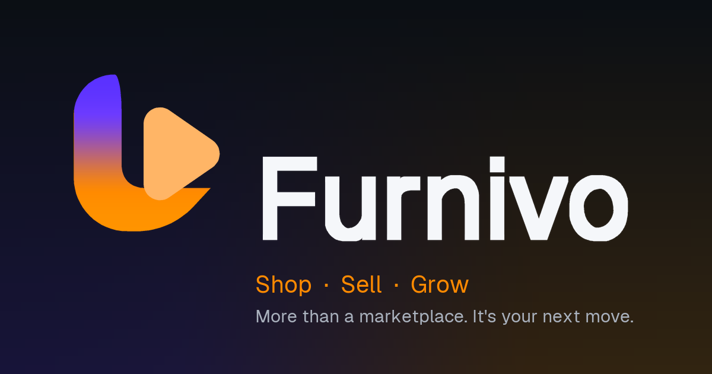

# Furnivo brand & interface reference

**Purpose:** implementation guide for the Furnivo visual identity and shared UI tokens. The supplied concept board was used as direction; the production marks below are clean, independently drawn vector assets—not crops of the board. No ™ or ® is included.



## Identity

- **Brand name:** Furnivo
- **Primary line:** “Shop · Sell · Grow”
- **Supporting line:** “More than a marketplace. It’s your next move.”
- **Mark:** a custom geometric bag/forward-play symbol with a separate wordmark. Every asset is generated from the outline of the Geist typeface and the mark's own vector paths by `scripts/brand/generate-brand-assets.py`, so the mark, wordmark, icons and social card cannot drift apart. Do not substitute emoji, the concept-board image, or a hand-built CSS approximation.
- **Asset naming:** files keep their historical `live-*` filenames. They are asset paths referenced in code and cached by browsers; renaming them would break image references for no visual gain. The *content* is Furnivo.
- The line is brand positioning, not a statement that every marketplace category or regulated workflow is currently enabled. The product must continue to show only workflows that are actually ready.

## Palette

| Token | Value | Intended use |
| --- | --- | --- |
| Royal Purple | `#6C3BFF` | Primary brand: buttons, links, focus rings, active indicators. White text on it is 5.66:1. |
| Deep Purple | `#4B22CC` | Hover/pressed state and compact brand text on light surfaces. White text is 8.75:1. |
| Sun Orange | `#FF8A00` | Secondary accent, gradient end, marketing highlights. **Charcoal text on it only** (8.13:1); never white. |
| Deep Charcoal | `#0B0F14` | Logo and wordmark ink, dark surfaces, primary button text. |
| Cloud White | `#F5F7FA` | Reverse wordmark and raised surfaces on dark. |
| Slate Gray | `#6B7280` | Secondary neutral reference; use darker `--live-muted` for small copy where needed. |
| Light Gray | `#F3F4F6` | Main light-theme canvas. |

The mark is a purple→orange vertical gradient (`#6C3BFF` → `#FF8A00`) with a lighter inner shape.

**Contrast rule:** white text is fine on Royal Purple (5.66:1) and Deep Purple (8.75:1) but **not** on Sun Orange (2.36:1). Use charcoal text on any orange fill (8.13:1). These ratios are calculated from the listed hex values with the WCAG relative-luminance formula; they are not a full WCAG audit. Success, warning, danger and info colours stay green/amber/red — they are semantic state, not brand colours, so the `emerald-*` utility classes in older components remain intentional.

The core values are centralized in `src/app/globals.css` and its Tailwind 4 `@theme` block. Token and utility names still read `live-*` (e.g. `--color-live-green`, `bg-live-green-ink`); these are internal identifiers used by thousands of class references and were deliberately **not** renamed during the rebrand. Existing component/page code should use those tokens rather than introducing new palette literals, so the next brand change is a one-file edit. Light/dark surface, text, muted, borders, focus, spacing, size, radii, shadows, motion, breakpoints, and layer tokens live in the same stylesheet.

## Logo asset directory

All paths below are relative to `public/` and are available at the matching site URL.

| Asset | Use |
| --- | --- |
| `brand/live-logo-horizontal.svg` | Primary horizontal lockup for light surfaces. |
| `brand/live-logo-horizontal-inverse.svg` | Reverse lockup for dark/black surfaces. |
| `brand/live-logo-horizontal-compact.svg` | Tighter horizontal lockup for constrained light layouts. |
| `brand/live-logo-horizontal-compact-inverse.svg` | Tighter reverse lockup for constrained dark layouts. |
| `brand/live-logo-horizontal-mono.svg` | Single-color black lockup. |
| `brand/live-logo-horizontal-mono-inverse.svg` | Single-color white lockup on dark surfaces. |
| `brand/live-wordmark.svg` | Wordmark-only use where the symbol is already present. |
| `brand/live-symbol.svg` | Standalone symbol for light surfaces. |
| `brand/live-symbol-inverse.svg` | White symbol for dark surfaces. |
| `brand/live-symbol-mono.svg` | Black single-color symbol. |
| `brand/live-app-icon.svg` | Rounded app-icon source artwork. |
| `brand/live-app-icon-maskable.svg` | Full-bleed maskable icon artwork with centered safe-area mark. |
| `brand/live-app-icon-light.svg` | Light-background icon artwork. |
| `brand/live-social-card.svg` / `brand/live-social-card.png` | Share-card source and 1200×630 raster image; Open Graph/Twitter metadata points to it only when `LIVE_PUBLIC_BASE_URL` or `NEXT_PUBLIC_APP_URL` passes the existing public-HTTPS URL validation. |
| `favicon.svg`, `icon.svg`, `icon-192.png`, `icon-512.png`, `icon-maskable-192.png`, `icon-maskable-512.png`, `apple-touch-icon.png`, and `src/app/favicon.ico` (a byte-identical copy of `public/favicon.ico`, because the App Router serves the app-directory file first) | Browser, PWA, and Apple touch icons. |

Use the shared React wrapper from `@/components/BrandLogo` for UI. It supports horizontal, inverse, monochrome, symbol, and wordmark variants. Keep logos proportionally scaled; do not recolor, add effects, or place the inverse version on a light background.

```tsx
<BrandLogo variant="horizontal" decorative />
<BrandLogo variant="inverse" decorative />
```

The site header chooses the light/dark lockup from the active theme; the merchant workspace, admin, auth screens, footer, manifest, and metadata use the appropriate local assets. No remote font or logo CDN is required.

## Interface tokens & behavior

- Theme selection continues to use the existing `system`, `light`, and `dark` modes. Dark theme keeps deep black as its base and lifts surfaces in layers.
- Primary text, muted text, borders, and focus rings use theme variables. Focus stays visible; keep interactive hit areas at least 44px where possible.
- Shared spacing, typography, sizing, radii, shadows, focus, motion, breakpoints, and stacking levels are defined in `globals.css`/Tailwind `@theme`. Existing responsive layout rules are preserved and should be checked at 320px, 375px, 768px, 1024px, 1440px, and 1920px when the correct validation environment is available.
- Reduced-motion preferences remain respected by the shared stylesheet.
- Listing pages should retain their real category-specific fields, current data, and availability caveats. Do not invent stock, sellers, locations, ratings, payments, delivery events, analytics, or enabled categories for a visual example.
- Keep all visible controls connected to their existing routes/state/API. A visual refresh must not remove server-side authorization, legal/readiness gates, data privacy controls, or error states.

## Rights & verification note

The mark and social artwork are original vector compositions created for this workspace. This implementation does **not** establish trademark/domain availability, rights clearance, registration, or legal approval. Review with appropriate counsel before external brand launch. WCAG conformance, browser compatibility, Core Web Vitals, and production build status are not claimed by this guide; test them before release.
